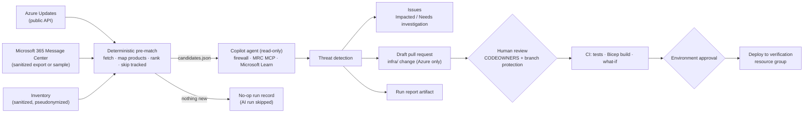

# Service-change impact workflow

Turn Microsoft service-change notices into evidence-based, human-approved actions in GitHub.

> **Status (2026-10-10): reviewed sample prototype.** The owner authorized making [amex678/service-change-impact-workflow](https://github.com/amex678/service-change-impact-workflow) public after checking its tracked history and outputs for real data and credentials. The [reviewed report](https://amex678.github.io/service-change-impact-workflow/) covers all 12 selected candidates: **2 Impacted, 2 Not impacted within stated scope, 8 Needs investigation**. It is an AI-assisted evidence review, not human approval or live-environment validation.

The six original findings were reviewed and corrected where needed: SMS policy enablement does not prove SMS primary sign-in; ADE is not the same as server-side encryption using a Disk Encryption Set; unclassified disks and unobserved TLS/SCM/cloud settings remain explicit gaps. [Draft PR #9](https://github.com/amex678/service-change-impact-workflow/pull/9) remains unmerged, with [PR-linked CI](https://github.com/amex678/service-change-impact-workflow/actions/runs/38010067772) and [offline infrastructure validation](https://github.com/amex678/service-change-impact-workflow/actions/runs/38010067790) passing.

The original [October 6 run](https://github.com/amex678/service-change-impact-workflow/actions/runs/37401375853) created Issues and the draft PR but failed to deliver the report despite its green status. Publication now validates every candidate row, stages Markdown/HTML/metadata deterministically, and fails a separate job if the required artifact is missing or inconsistent. The reviewed replay is not represented as recovery of the unpublished original report.

**Live verification:** [run 38012531004](https://github.com/amex678/service-change-impact-workflow/actions/runs/38012531004) passed all six jobs, including `verify-report`, and delivered the complete 12-candidate report artifact. It created four new investigation Issues without duplicating original findings or PR 9. The reviewed Pages report corrects a raw-run assertion that an unclassified disk was a data disk; automated shape/delivery checks do not prove factual correctness.

> **Demo boundary:** public reports accept synthetic inventory and fictional Microsoft 365 inputs only. No automatic merge, Azure deployment or Microsoft 365 setting change is authorized. Azure credentials/variables are not configured; daily analysis and generated maintenance remain disabled. Approval enforcement and actual runtime smoke tests remain unverified. See [governance](docs/governance.md).

## Why

Azure Updates published 1,822 notices between October 2024 and September 2026, and 195 announced retirements fall in 2026 or later (measured on 2026-10-01 from the public Release Communications API). Microsoft 365 Message Center adds tenant-specific notices. Reading a notice does not tell an operations team whether **their** environment is affected, what the evidence is, or who must act by when. This workflow does that triage continuously and hands every decision to a person.

## How it works



1. **Deterministic steps** (`scripts/`) fetch Azure Updates, including still-relevant retirements, map inventory resource types to Azure Updates product names, rank candidates, and skip notices already tracked by an Issue. When nothing needs evaluation they record a no-op and the AI run is skipped.
2. **The agent** ([`.github/workflows/service-change-impact.md`](.github/workflows/service-change-impact.md)) reads the prepared candidates, checks each notice's conditions against the configuration, and gives one of four verdicts: *Impacted*, *Not impacted*, *Needs investigation* or *Cannot evaluate*. A trusted post-step validates exact candidate coverage and publishes the report files; a final job verifies their delivery.
3. **Safe outputs** turn verdicts into Issues and, for Azure changes that are declared in `infra/`, at most one **draft** pull request. Microsoft 365 notices stop at an Issue; the workflow never changes tenant settings.
4. **People decide.** The intended Azure delivery uses pull request approval and a second environment approval ([`infra-deploy.yml`](.github/workflows/infra-deploy.yml)). These gates are not demonstrated in this sample deployment; no Azure change is authorized here.

## Demo golden path (about 3 minutes)

| Step | What the audience sees |
|---|---|
| 1. Run `service-change-impact` manually | Step summary: live Azure notices plus 4 sample Microsoft 365 notices reduced to a short ranked candidate list (on 2026-10-01: 206 Azure notices → 12 candidates), with coverage gaps and warnings |
| 2. Reviewed verdicts | Azure 572770: *Impacted* for PowerShell 7.4. Azure 500157: *Impacted* for `disks-01`, other disk roles treated separately. TLS: application endpoint already excludes legacy TLS, but SCM/clients need investigation. Sample SMS: *Needs investigation* because primary sign-in was not captured |
| 3. Draft pull request (expected) | `infra/main.bicep`: `powerShellVersion` 7.4 → 7.6, with risks, validation and rollback |
| 4. Human gates | Show the passing draft-PR checks and the remaining approval/runtime-validation steps. Do not claim enforced approval or deployment |

The inventory and Microsoft 365 data in this repository are synthetic samples (`"sample": true`), and every output says so.

## Roles

| Role | Responsibility |
|---|---|
| Operations reviewer | Triages the Issues, confirms or corrects verdicts, sets owners and dates |
| IaC owner (CODEOWNERS) | Reviews and approves draft pull requests under `infra/` |
| Microsoft 365 administrator | Acts on Microsoft 365 Issues; no automated tenant change exists |
| Environment approver | Approves each deployment to the verification (later, production) environment |
| Workflow maintainer | Edits the workflow Markdown, recompiles it, maintains the product map, secrets and schedule |

## Prerequisites

- A GitHub repository with Actions enabled, and the [GitHub Agentic Workflows](https://github.github.com/gh-aw/) CLI extension to compile workflows (`gh extension install github/gh-aw`; compiled with v0.81.6).
- Copilot engine authentication: the `COPILOT_GITHUB_TOKEN` secret (fine-grained PAT with **Copilot Requests: Read**) for personal repositories, or `permissions: copilot-requests: write` where the organization has centralized Copilot billing.
- Python 3.10 or later for local runs (standard library only).
- Optional: an Azure subscription and a Microsoft Entra app with a federated credential for `infra-deploy.yml`, and read access for exporting your own inventory.

Step-by-step instructions: [docs/setup.md](docs/setup.md).

## Governance and human-in-the-loop

- **Least privilege.** The agent job can only read `contents`, `issues` and `pull-requests`. Writes happen in a separate job through safe outputs with limits: at most 6 Issues and 1 draft pull request per run, titles de-duplicated across runs, protected files enforced.
- **Threat detection** reviews the agent's output for prompt injection, secret leaks and malicious patches before anything is written.
- **Network and tools allowlists.** The firewall allows only default infrastructure plus `www.microsoft.com`, `azure.microsoft.com` and `learn.microsoft.com`. The MCP server exposes two read-only tools.
- **Data boundary.** The inventory is sanitized: no subscription, tenant or resource IDs, no tags, and pseudonymous names. Raw exports stay in the git-ignored `data/raw/`. Microsoft 365 quotes are limited to one sentence.
- **Truthfulness.** An incomplete fetch never produces a no-op. Deferred or unmapped items are reported as *not evaluated*, never as *not impacted*.
- **Two human gates for Azure changes.** Pull request approval, then environment approval. Microsoft 365 changes stay manual.
- **Audit trail.** Issues and pull requests carry a workflow marker. Each run leaves a report artifact (30 days), a step summary, and a comment on the no-op runs Issue when nothing was found.

Details and the threat model: [docs/governance.md](docs/governance.md).

## Success measures

| Measure | Target | How it is measured |
|---|---|---|
| Notices a person must read per run | 12 or fewer candidates instead of every new notice plus all open retirements | `counts` in `run/candidates.json` |
| Time from notice to triaged Issue | Less than 1 day once the daily schedule is on | Issue `created_at` minus notice `created` |
| Evidence completeness | Every *Impacted* Issue cites the notice condition and the matching value | Reviewer checklist |
| False "no impact" | None: incomplete inputs are never reported as *not impacted* | Unit tests and the report's warnings |
| Controlled change | Every `infra/` change goes through an approved pull request and environment approval | Branch protection and deployment history |

The manual baseline (time and steps to triage the same notices by hand) is still to be measured for the submission.

## Repository layout

```text
.github/workflows/service-change-impact.md        Agentic workflow (source, edit this)
.github/workflows/service-change-impact.lock.yml  Compiled GitHub Actions workflow (generated)
.github/workflows/ci.yml                          Unit tests, Bicep build, actionlint
.github/workflows/infra-deploy.yml                Human-approved deployment of infra/
.github/copilot-instructions.md                   Guidance for GitHub Copilot in this repository
scripts/                                          Deterministic fetch, sanitize and pre-match steps
config/                                           Product map, evidence hints, property whitelist
data/samples/                                     Synthetic inventory and Microsoft 365 data
templates/impact-report.md                        Report format used by the agent
infra/main.bicep                                  Demo environment the draft pull request edits
tests/                                            Unit tests (python -m unittest)
docs/                                             Setup and governance
```

## Starting assets and original contributions

- **Generated by GitHub Agentic Workflows (MIT)** with `gh aw init` and `gh aw compile`: `.github/agents/agentic-workflows.md`, `.github/skills/agentic-workflow*/`, `.github/workflows/copilot-setup-steps.yml`, `.github/mcp.json`, `.github/aw/actions-lock.json`, `.gitattributes`, and every `*.lock.yml`.
- Its required copyright and license notice is preserved in [THIRD-PARTY-NOTICES.md](THIRD-PARTY-NOTICES.md).
- **Data**: Azure Updates from Microsoft's public Release Communications API (read at run time; `config/azure-updates-products.json` is a snapshot of its product names).
- **Original work in this repository**: the workflow instructions and configuration, all scripts and tests, configuration maps, synthetic samples, the report template, the demo Bicep, the CI and deployment workflows, and the documentation. The four-verdict rubric comes from the author's earlier manual impact assessments.

## Status and limitations

Verified locally on 2026-10-01:

- Live fetch from the public API. Paging is explicit because the API omits `@odata.nextLink` when `$top` is set, and results are de-duplicated. With a stable sort, 57 recent and 195 retirement notices were retrieved completely.
- The pre-match against the samples ranks the demo notices first.
- 33 unit tests pass.
- `gh aw compile` (v0.81.6) reports 0 errors and 0 warnings.
- `az bicep build` succeeds.

Reviewed on 2026-10-10:

- All 12 selected candidates and the six original finding Issues, with source conditions and sample configuration.
- Draft PR 9 has passing PR-linked tests, Bicep build, actionlint and offline infrastructure validation.
- Report validation rejects missing/duplicate verdicts, invalid verdicts, incomplete inputs treated as no impact, malformed newline formatting, unsafe links and tampered/missing report files.
- Workflow compilation succeeds in strict mode; public output refuses real inventory/tenant inputs.

Not yet verified:

- No-op skipping on GitHub Actions, human approval enforcement, real-environment accuracy or runtime compatibility.
- `infra-deploy.yml` against Azure; no deployment was performed.

Verified on GitHub on 2026-10-06: unit tests, Bicep build and actionlint ([CI evidence](https://github.com/amex678/service-change-impact-workflow/actions/runs/37398436326)). The initial lint failure was resolved by disabling generated maintenance and adding a file-specific compatibility exception for gh-aw's `concurrency.queue`; other lint diagnostics remain enabled.

Known limitations:

- **Microsoft 365 uses samples.** An unattended export needs Microsoft Graph `ServiceMessage.Read.All` (application permission) with admin consent ([reference](https://learn.microsoft.com/graph/api/serviceannouncement-list-messages?view=graph-rest-1.0)).
- **Verdicts depend on captured configuration.** The agent can only judge what the inventory records; missing facts lead to *Needs investigation*.
- **Coverage is limited to mapped types.** The product map covers common resource types; unmapped types are listed in every report.
